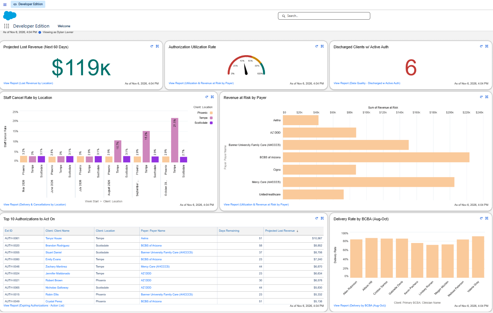
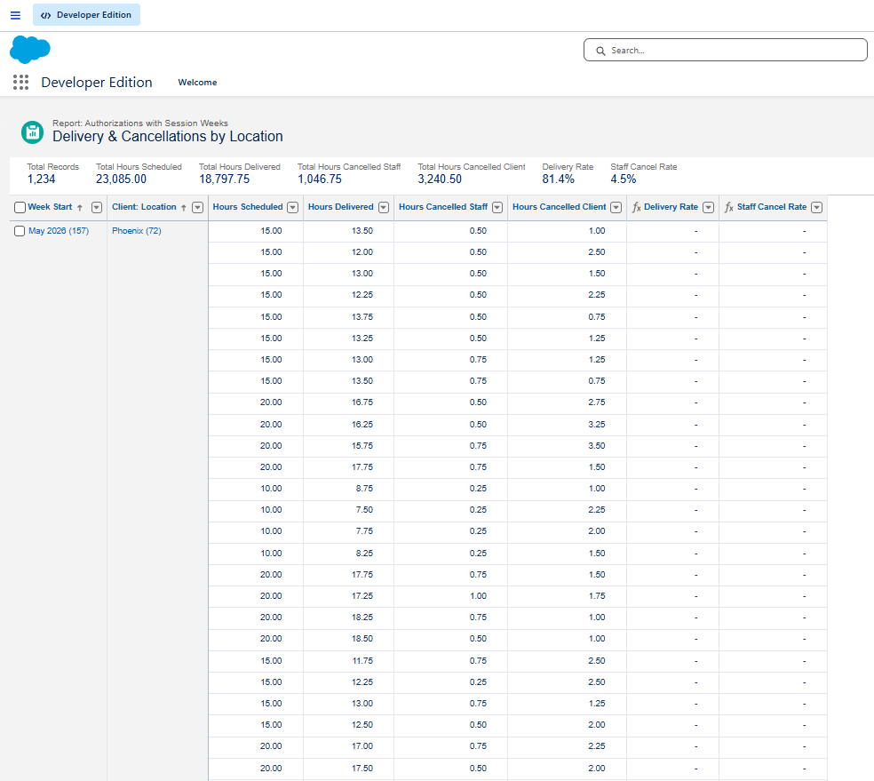
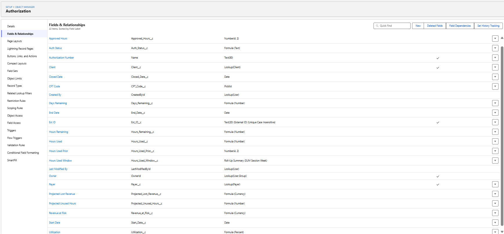
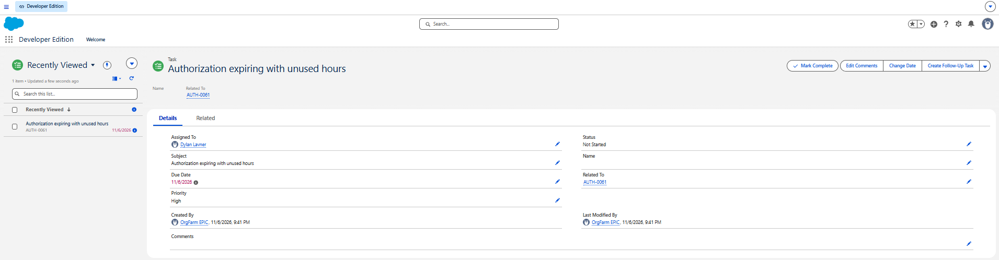
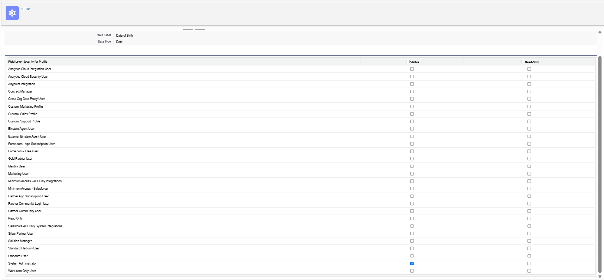

# ABA Utilization & Authorization Command Center (Salesforce)

A Salesforce operations system for a mock ABA (Applied Behavior Analysis) provider with three clinics. It tracks payer authorizations, weekly service delivery and cancellations; surfaces revenue at risk; and automates fixes with Flow.

> **All data is synthetic**, generated with Python. It contains no real clients, staff or PHI. Payer names are used for realism; rates are fictional.

## The problem
ABA providers can only bill hours a payer has **authorized** in advance, usually in 6-month blocks. Any authorized hour not delivered before the end date is lost revenue and missed therapy. Operations needs to know where hours are lost, how much is at risk, and which authorizations need action now.

## Key findings
| Finding | Result |
|---|---|
| Tempe staffing problem | Staff-cancelled hours rose from **3% → 21%** (May → Oct); delivery fell to 68% |
| Site-wide, not one clinician | All 3 Tempe BCBAs at 72–76% delivery vs. 84–91% elsewhere |
| Projected lost revenue | **~$119K** across 23 authorizations expiring in ≤60 days |
| Payer renewal gaps | Cigna and UnitedHealthcare clients waited 1–3 weeks between authorizations |
| Data quality | 6 discharged clients with active authorizations, **fixed with automation** |

**Leadership memo:** [MEMO.md](MEMO.md)

## What I built
**Data model:** 5 custom objects (Payer, Clinician, Client, Authorization, Session Week) with lookups, a master-detail relationship, a roll-up summary and cross-object formulas.

| Calculated field | Logic |
|---|---|
| Utilization | Hours used ÷ approved hours |
| Days Remaining | End Date − TODAY() |
| Auth Status | Closed / Expired / Active |
| Projected Unused Hours | Hours remaining that can't be delivered even at full attendance before the End Date |
| Projected Lost Revenue | Projected unused hours × payer rate |

**Data load:** 1,402 records loaded with Data Import Wizard, linked through External IDs, with 0 errors.

**Reports and dashboard:** 5 reports on 2 custom report types (built at different grains to avoid double-counting), summary formulas for hours-weighted utilization, and a 7-widget dashboard.

**Automation (Flow):**
- *Close Authorizations on Discharge* (record-triggered): closes open authorizations when a client is discharged. Re-run safe; used to backfill 6 records.
- *Expiring Authorization Alert* (schedule-triggered, daily): creates a high-priority task when an authorization hits 30 days left with under 70% used.

**Security and HIPAA:** PHI fields (name, DOB) hidden through field-level security and granted through a least-privilege permission set; field history tracking on authorization dates and hours.

## Screenshots
| | |
|---|---|
|  |  |
| Staff cancellations by location | Authorization fields and formulas |
|  |  |
| Automated expiration alert | PHI field-level security |

## Tools
Salesforce (Developer Edition): Object Manager, Reports and Dashboards, Flow Builder, Data Import Wizard, Permission Sets · Python (Faker) for synthetic data

## Reproduce it
1. `pip install faker` → `python generate_data.py` (seed fixed, output reproducible)
2. Follow [docs/BUILD_GUIDE.md](docs/BUILD_GUIDE.md) to build the objects and load the data

## Related
[Project 2: ABA Revenue Cycle Analysis (SQL + Power BI)](https://github.com/YOUR-USERNAME/aba-revenue-cycle-sql), which joins this Salesforce data with EHR sessions and insurance claims.
